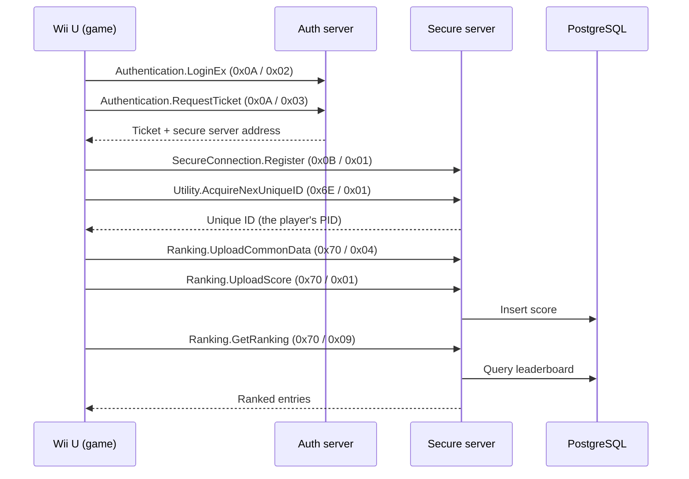

# Nano Assault Neo (Wii U) — NEX server

> If you use this source base, please credit us, as well as the other contributors mentioned in this repository.

Built on the [Pretendo Network](https://github.com/PretendoNetwork) NEX
libraries (`nex-go`, `nex-protocols-go`, `nex-protocols-common-go`) — the
same stack as this org's other servers.

## Recovered configuration

| Field           | Value |
|-----------------|-------|
| Game server ID  | `10110100` |
| Access key      | `7e484a8e` |
| NEX library version | `3.0.1` |

## How the game talks to the server

The game communicates over **NEX**, Nintendo's RPC layer built on **PRUDP**
(UDP). Every request is an RMC message identified by a **protocol ID** and a
**method ID**. The server exposes two UDP endpoints:

| Server         | Purpose                                      |
|----------------|----------------------------------------------|
| Authentication | Login and ticket issuing                     |
| Secure         | Everything after login (register, ranking)   |

### Connection sequence



### Protocols used

| Protocol          | ID     | Method               | ID     | What it does |
|-------------------|--------|----------------------|--------|--------------|
| Authentication    | `0x0A` | `LoginEx`            | `0x02` | Identifies the player and starts the login |
| Authentication    | `0x0A` | `RequestTicket`      | `0x03` | Issues the ticket for the secure server |
| Secure Connection | `0x0B` | `Register`           | `0x01` | Registers the session on the secure server |
| Utility           | `0x6E` | `AcquireNexUniqueID` | `0x01` | Gives the player a unique ID. **Required**: without a reply the game stalls and never reaches ranking |
| Ranking           | `0x70` | `UploadScore`        | `0x01` | Sends a score |
| Ranking           | `0x70` | `UploadCommonData`   | `0x04` | Sends player metadata (name and other game data) |
| Ranking           | `0x70` | `GetRanking`         | `0x09` | Requests the leaderboard |

### Step by step

1. **Authentication.** The game contacts the auth server, which validates the
   account and returns a ticket plus the secure server address.
2. **Secure connection.** The game connects to the secure server and calls
   `Register`.
3. **Unique ID.** The game calls `AcquireNexUniqueID`; the server answers with
   the player's PID, which is stable between sessions.
4. **Upload.** At the end of a run the game sends its metadata
   (`UploadCommonData`) and its score (`UploadScore`). The handlers in
   `database/` write both to PostgreSQL.
5. **Read.** When the player opens the leaderboard, the game sends
   `GetRanking`. The server queries PostgreSQL and returns a list of
   `RankingRankData` entries (rank, PID, unique ID, score, common data,
   update time).

### Parameters seen in practice

- `UploadScore` carries a `RankingScoreData`: `Category`, `Score`, `OrderBy`,
  `UpdateMode`, `Groups`, `Param`.
- `GetRanking` carries a `RankingOrderParam`: `OrderCalculation`,
  `GroupIndex`, `GroupNum`, `TimeScope`, `Offset`, `Length`. The game
  typically asks for `TimeScope: 2` and `Length: 255`.

### Debugging

The secure server logs every incoming call:

```
[NAN Secure] PID=<pid> protocol=0x70 method=0x09
```

If the game seems stuck, look at the last `protocol` / `method` pair. A call
that shows up in the logs but has no registered handler (as happened with
`0x6E` Utility) means the client is waiting for a reply that never comes.

## Running it

Docker is the easy way:

```bash
cp .env.example .env
cp settings.example.json settings.json
docker compose up --build
```

Make sure UDP ports `27100` and `27101` are reachable from the internet
(firewall and Docker port mappings).

## License

AGPL-3.0. See [LICENSE](LICENSE) and [NOTICE](NOTICE). No proprietary
